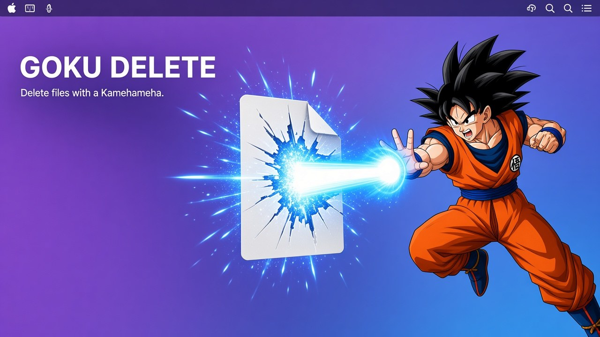
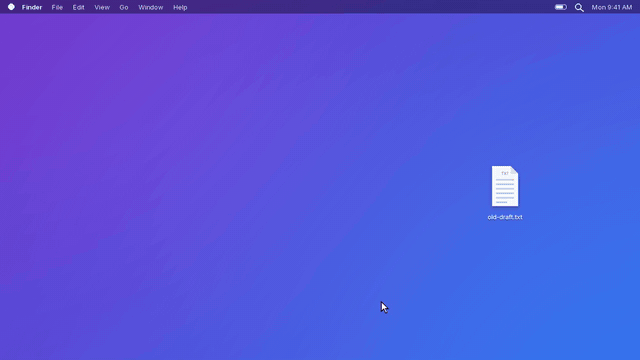
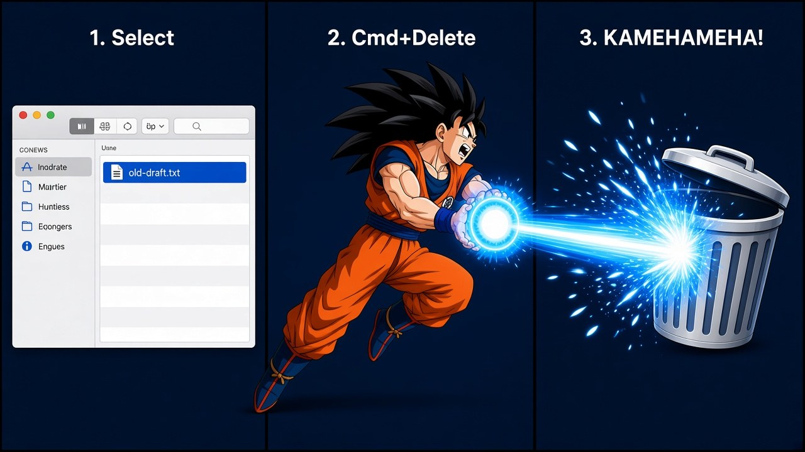

# Goku Delete

**Delete a file in Finder and a tiny Goku flies in from a random spot on your screen, charges up, and blasts it away with a Kamehameha.** The file goes to the Trash only when the beam hits it.

[](docs/promo.mp4)

▶️ **[Watch the promo video](docs/promo.mp4)** (10 s, no sound)

*(Illustration of the effect. On a real desktop Goku is about twice the size of a Dock icon and the beam can cross windows and displays.)*

## How it works



1. **Select** a file in Finder.
2. Press **Cmd+Delete** (or choose File > Move to Trash).
3. Goku flies in, charges, and fires. **KAMEHAMEHA!** The file goes to the Trash the moment the beam hits.

## What it does under the hood

- Runs as a small background agent (no Dock icon, no menu bar item, no sound).
- Watches Finder for **Cmd+Delete** and **File > Move to Trash**.
- Finds where the selected file icons are on screen (Accessibility API), then draws a transparent, click-through overlay across **all** your displays.
- Goku appears from a random edge or corner, charges, and fires. The beam can reach from anywhere on the desktop to anywhere else, not just inside one window.
- When the beam hits, Finder moves the file to the Trash the normal way, so **Put Back still works**.
- Safe by design: if anything goes wrong (it can't find the icons, the selection changes, or 6 seconds pass), it just does a normal delete. It never deletes anything you didn't ask Finder to delete.

Requires macOS 13 or later (tested on Apple Silicon) and the Xcode Command Line Tools.

## Install

```bash
git clone https://github.com/Rayz-x/Goku-Delete.git
cd Goku-Delete
./install.sh
```

The installer:

1. Checks you're on macOS and that the Xcode Command Line Tools are installed. If they aren't, it opens the `xcode-select --install` dialog; run `./install.sh` again when that finishes.
2. Compiles `src/main.swift` with `swiftc` and builds `GokuDelete.app`.
3. Ad-hoc signs it (`codesign --force --deep -s -`) and installs it to `/Applications`. It asks for your password only if `/Applications` isn't writable.
4. Writes and loads a per-user LaunchAgent (`~/Library/LaunchAgents/com.github.rayzx.gokudelete.plist`) so it starts at login.
5. Opens **System Settings > Privacy & Security > Accessibility** and shows the app in Finder.

Options: `INSTALL_DIR=~/Applications ./install.sh` installs somewhere else, and `BUNDLE_ID=com.you.gokudelete ./install.sh` uses your own bundle id. Pass the same values to `uninstall.sh`.

## Grant Accessibility (required)

Goku needs Accessibility permission to see your Delete keypress and find the file icons.

1. In **System Settings > Privacy & Security > Accessibility** (on newer macOS versions this pane may have a slightly different name), find **GokuDelete** and switch it **on**.
2. If it isn't listed, click **+**, choose `/Applications/GokuDelete.app`, and switch it on. You can also drag the app in from the Finder window the installer opened.
3. Within a few seconds the log should say `event tap installed`:
   ```bash
   tail -f ~/Library/Logs/GokuDelete.log
   ```

## Test it safely

Use a throwaway file, not something you care about:

```bash
echo "kamehameha" > ~/Desktop/goku-test.txt
```

Select `goku-test.txt` in Finder and press **Cmd+Delete**. Goku blasts it, and it lands in the Trash. Right-click it in the Trash and choose **Put Back** to restore it.

To watch the animation without deleting anything (Goku fires at your mouse pointer):

```bash
/Applications/GokuDelete.app/Contents/MacOS/GokuDelete --test
```

To check whether the permission is active:

```bash
/Applications/GokuDelete.app/Contents/MacOS/GokuDelete --check   # prints trusted / not-trusted
```

## Turn it off or uninstall

Pause it until next login:

```bash
launchctl bootout gui/$(id -u)/com.github.rayzx.gokudelete
```

Remove it completely (app, LaunchAgent, logs and the Accessibility entry; your files are not touched):

```bash
./uninstall.sh
```

## Troubleshooting

**The app won't appear in the Accessibility list, or it's on but Goku never shows up.**
macOS ties the Accessibility grant to the app's exact code signature. Every rebuild or re-sign, including re-running `install.sh`, produces a new signature, and the old entry stops matching. A stale entry can also block the new one from being added. Fix:

1. In Accessibility, select the old **GokuDelete** row and remove it with **−**. Or reset it from Terminal:
   ```bash
   tccutil reset Accessibility com.github.rayzx.gokudelete
   ```
2. Add `/Applications/GokuDelete.app` again with **+** and switch it on.
3. Restart the agent:
   ```bash
   launchctl kickstart -k gui/$(id -u)/com.github.rayzx.gokudelete
   ```

**`tccutil` fails with error -10814, or System Settings silently ignores the app you pick.**
LaunchServices doesn't know where the app is. This usually happens because it's still registered at an old location, for example after you moved it or installed an earlier copy in `~/Applications`. Re-register the app, then try again:

```bash
/System/Library/Frameworks/CoreServices.framework/Frameworks/LaunchServices.framework/Support/lsregister -f /Applications/GokuDelete.app
```

Delete any other copies of `GokuDelete.app` so only one is registered. If an old entry still won't clear, install under a different bundle id (`BUNDLE_ID=com.you.gokudelete ./install.sh`) to start fresh.

**Build fails with `unable to load standard library for target ...`.**
Your selected Xcode and Command Line Tools SDKs don't match. Run `sudo xcode-select --reset` (or `sudo xcode-select -s /Library/Developer/CommandLineTools`) and re-run `./install.sh`. The installer uses Apple's `/usr/bin/swiftc` shim; override with `SWIFTC=/path/to/swiftc ./install.sh` if needed.

**"GokuDelete can't be opened" / Gatekeeper warnings.**
The app is built on your Mac and ad-hoc signed, not notarized. Since it's launched by the LaunchAgent and not by double-clicking, this is normally fine. If macOS still complains, run `xattr -cr /Applications/GokuDelete.app`.

**Deletes feel normal and there's no Goku.**
Check `~/Library/Logs/GokuDelete.log`. The log shows `Accessibility not granted yet` until permission is granted. If Finder's sidebar has focus, or the selection can't be read, the delete passes through normally. That's by design.

## Project layout

```
src/main.swift            the agent (event tap, AX lookup, overlay, animation)
Resources/Info.plist      app bundle template (bundle id filled in by install.sh)
Resources/goku_*.png      Goku sprite frames (charge + fire)
install.sh / uninstall.sh
docs/                     README images, promo video and GIF
```

## Disclaimer

This is an unofficial, non-commercial fan project. It is not affiliated with or endorsed by Toei Animation, Shueisha, Bird Studio, or any Dragon Ball rights holder. Dragon Ball Z and Goku belong to their respective owners. The MIT license covers this project's code only.
